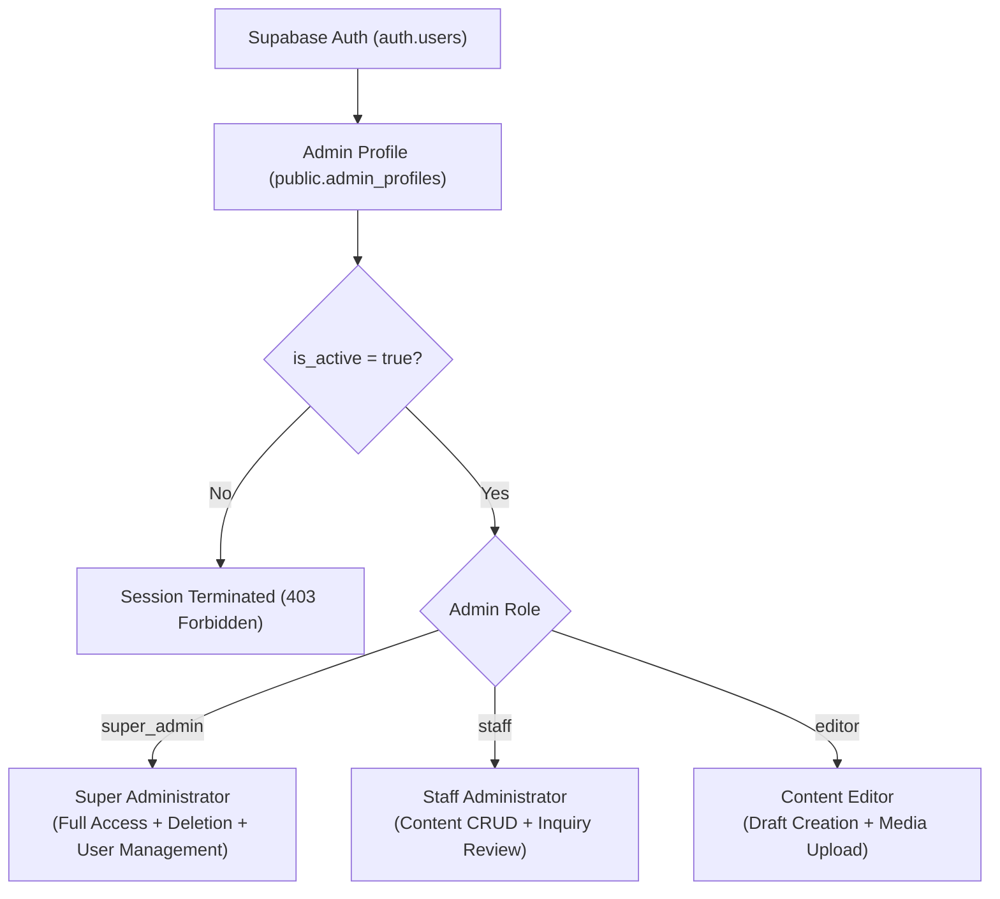

# OM OPEN MINDS — Admin Roles & Permission Matrix

> **Document:** `docs/admin-permissions.md`  
> **Institution:** OM OPEN MINDS  
> **Phase:** Phase 4 Access Control Specification  
> **Enforcement Level:** Database Kernel (PostgreSQL Row Level Security)

---

## 1. Role Hierarchy & Principles

OM OPEN MINDS deploys a **zero-trust, database-enforced role-based access control (RBAC)** architecture. Roles are stored in `public.admin_profiles` and evaluated via `SECURITY DEFINER` database functions. Client-side route checks are supplementary only.



---

## 2. Granular Permissions Matrix

| Module / Table | Public Role | Staff Admin (`staff`) | Super Admin (`super_admin`) | Security Enforcement |
| :--- | :---: | :---: | :---: | :--- |
| **`admin_profiles`** | 🚫 None | View Own Profile | View, Create, Update, Delete All | PostgreSQL RLS |
| **`site_settings`** | 👁️ Read Only | ✏️ Read, Create, Update | ✏️ Full CRUD | `is_admin()` policy |
| **`core_pillars`** | 👁️ Read (Active) | ✏️ Full CRUD | ✏️ Full CRUD | `is_admin()` policy |
| **`programmes`** | 👁️ Read (Active) | ✏️ Full CRUD | ✏️ Full CRUD | `is_admin()` policy |
| **`facilities`** | 👁️ Read (Active) | ✏️ Full CRUD | ✏️ Full CRUD | `is_admin()` policy |
| **`team_members`** | 👁️ Read (Active) | ✏️ Full CRUD | ✏️ Full CRUD | `is_admin()` policy |
| **`activities`** | 👁️ Read (Active) | ✏️ Full CRUD | ✏️ Full CRUD | `is_admin()` policy |
| **`announcements`** | 👁️ Read (Active & Valid Date) | ✏️ Full CRUD | ✏️ Full CRUD | `is_admin()` policy |
| **`gallery_categories`**| 👁️ Read (Active) | ✏️ Full CRUD | ✏️ Full CRUD | `is_admin()` policy |
| **`gallery_items`** | 👁️ Read (Published & Consented) | ✏️ Full CRUD | ✏️ Full CRUD | Parental consent check + RLS |
| **`parent_resources`** | 👁️ Read (Active) | ✏️ Full CRUD | ✏️ Full CRUD | `is_admin()` policy |
| **`admissions_faqs`** | 👁️ Read (Active) | ✏️ Full CRUD | ✏️ Full CRUD | `is_admin()` policy |
| **`admission_enquiries`**| ➕ Insert Only (No Read) | 👁️ Read, Update Status/Notes | 🗑️ Delete/Purge Allowed | `is_super_admin()` for DELETE |
| **`contact_enquiries`** | ➕ Insert Only (No Read) | 👁️ Read, Update Status/Notes | 🗑️ Delete/Purge Allowed | `is_super_admin()` for DELETE |

---

## 3. Storage Bucket Permissions

| Storage Bucket | Public Access | Staff Admin Access | Allowed MIME Types | Size Limit |
| :--- | :---: | :---: | :---: | :---: |
| **`public-school-assets`** | 👁️ Read (Public URL) | ⬆️ Upload, Update, Delete | JPG, PNG, WebP, SVG | 2 MB |
| **`approved-gallery`** | 👁️ Read (Public URL) | ⬆️ Upload, Update, Delete | JPG, PNG, WebP | 2 MB |
| **`private-administrative-files`** | 🚫 **Strictly Denied** | 👁️ Read, Upload, Delete | PDF, XLSX, CSV | 5 MB |

---

## 4. Provisioning New Administrative Accounts

Public self-registration is permanently blocked. New staff accounts are provisioned via this two-step process:

### Step 1: Create Account in Supabase Auth
In the Supabase Dashboard:
1. Navigate to **Authentication** $\rightarrow$ **Users** $\rightarrow$ **Add User**.
2. Enter the employee's official email address and a temporary secure password.
3. Copy the generated User ID (`UUID`).

### Step 2: Register Admin Profile in PostgreSQL
Execute in the Supabase SQL Editor:
```sql
INSERT INTO public.admin_profiles (id, full_name, role, is_active)
VALUES (
  'PASTE_AUTH_USER_UUID_HERE',
  'Staff Member Full Name',
  'staff', -- or 'super_admin'
  true
);
```
