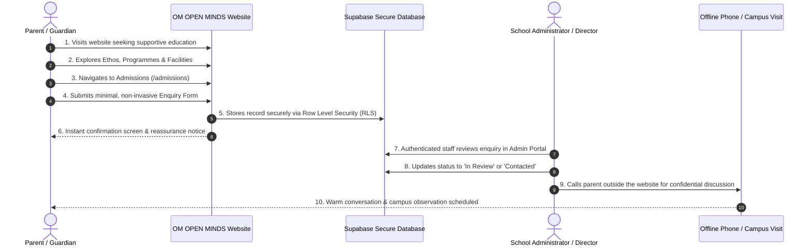

# OM OPEN MINDS — Admissions Enquiry Workflow Specification

> **Document:** `docs/admissions-workflow.md`  
> **Institution:** OM OPEN MINDS (Specialized School for Children with Diverse Learning Needs)  
> **Phase:** Phase 2 Admissions Journey & Privacy Protocol  
> **Status:** Standard Operating Procedure (SOP) Baseline

---

## 1. Ethical Foundation & Child Privacy Mandate

In standard education websites, admissions forms often act as rigid gatekeepers requiring extensive personal data. In a specialized school for children with disabilities, **this paradigm is ethically unacceptable and legally hazardous**:

1. **No Sensitive Diagnostic Requests:** The public admission enquiry form **MUST NEVER** request, demand, or require medical diagnoses, psychological assessments, therapy reports, or disability classification codes.
2. **Confidentiality by Design:** Formal medical evaluations, IEP diagnostic documents, and developmental assessments belong exclusively in secure, confidential clinical consultations held in person or via verified private communication channels.
3. **Gentle, Non-Intimidating Intake:** The web enquiry is purely an invitation to begin a supportive conversation between the family and the school leadership.
4. **Data Minimization:** We collect only the minimum actionable data required to address the parent respectfully and schedule an introductory conversation.

---

## 2. The 8-Stage Parent Admissions Journey



---

## 3. Detailed Stage-by-Stage Breakdown

### Stage 1: Parent Visits Website
* **Context:** The parent may be experiencing anxiety, confusion, or exhaustion from previous experiences in mainstream institutions that lacked accommodation for their child.
* **Experience:** The homepage greets them with a calming, reassuring affirmation of every child's inherent value. No flashing animations, clinical jargon, or aggressive sales pitches.

### Stage 2: Parent Explores School Information
* **Action:** The parent reviews:
  * `/about` to confirm institutional credibility and founding mission.
  * `/our-approach` to understand how Individualized Education Plans (IEPs) and multidisciplinary support work.
  * `/facilities` to verify physical safety, sensory suites, and wheelchair accessibility.
  * `/programmes` to see how learning pathways are organized by developmental stage rather than rigid grades.

### Stage 3: Parent Navigates to Admissions
* **Action:** The parent clicks "Schedule a Consultation" or visits `/admissions`.
* **Experience:** The page immediately outlines the **3-Step Consultative Pathway**:
  1. *Initial Discovery Conversation* (informal talk about the child's joys and daily routine).
  2. *Gentle Campus Observation Visit* (pressure-free campus exploration).
  3. *Collaborative IEP Roadmap* (co-creating developmental goals).

### Stage 4: Parent Submits the Enquiry Form
* **Interface:** Accessible form with clear visual labels, generous hit targets, and inline error feedback.
* **Fields Structure:**

| Field Label | Technical Name | Type | Requirement | Privacy & Justification |
| :--- | :--- | :--- | :---: | :--- |
| **Parent / Guardian Name** | `parent_name` | Text | **Mandatory** | Enables respectful communication. |
| **Email Address** | `email` | Email | **Mandatory** | For sending receipt confirmation and official correspondence. |
| **Primary Telephone** | `phone` | Tel | **Mandatory** | Direct channel for scheduling the initial discovery call. |
| **Child's First Name** | `child_name` | Text | **Mandatory** | Allows school staff to refer to the child warmly by name during the call. |
| **Child's Age** | `child_age` | Number | *Optional* | Provides general developmental context (e.g., Early vs. Primary readiness). |
| **Preferred Programme** | `preferred_program` | Dropdown | *Optional* | Indicates which pathway caught the parent's interest. |
| **Notes / Questions** | `notes` | Textarea | *Optional* | Open-ended field for any scheduling notes or general questions. |

> **STRICT ENFORCEMENT:** The form includes a prominent notice:  
> *"Please note: To protect your child's privacy, do not submit medical reports or diagnostic evaluations through this form. Clinical assessments and developmental records will be reviewed confidentially during your campus consultation."*

### Stage 5: Enquiry Stored Securely in Supabase
* **Mechanism:** Data is transmitted over HTTPS directly to the `admissions_inquiries` table.
* **Security & RLS:**
  * Public anonymous role has `INSERT WITH CHECK (true)` permission only.
  * Public anonymous role has **ZERO SELECT, UPDATE, or DELETE** access.
  * No public user can view other parents' submitted enquiries.
  * The record status automatically initializes to `'pending'`.
  * Timestamps (`created_at`) are generated by database server clock.

### Stage 6: Submission Confirmation
* **Screen Display:** The form unmounts, and an accessible confirmation card appears:
  * Announced immediately to screen readers via `role="status"` and `aria-live="polite"`.
  * Text reads: *"Thank you, [Parent Name]. We have received your inquiry regarding [Child Name]. A member of our admissions team will call you within 1–2 school days to discuss how we can support your child's learning journey."*
  * Contact hotline is reiterated in case the parent needs immediate assistance.

### Stage 7: Administrator Reviews Enquiry
* **Interface:** Administrative Back-Office at `/admin/dashboard/inquiries`.
* **Workflow:**
  * Administrator logs in with Supabase Auth credentials.
  * New inquiries appear in the "Pending Review" tab with clear timestamps.
  * Administrator opens the inquiry detail modal to review family details and notes.

### Stage 8: Administrator Updates Status & Takes Action Outside Website
* **Administrative State Machine:**

```text
[pending] ──(Staff reviews lead)──> [in_review]
    │                                    │
    │                              (Staff phones parent)
    │                                    │
    ▼                                    ▼
[archived] <──(Not proceeding)───── [contacted]
                                         │
                                   (Appointment set)
                                         │
                                         ▼
                             [consultation_scheduled]
```

* **Offline Contact:** School leadership or the admissions counselor places a warm, unhurried telephone call directly to the parent.
* **Internal Log:** The administrator records notes in `internal_admin_notes` (e.g., *"Spoke with mother on Nov 8; discussed early intervention; scheduled campus observation visit for Tuesday, Nov 17 at 10:30 AM"*).
* **Final Disposition:** Status updates to `consultation_scheduled`. Once completed, the inquiry is preserved in the audit log for longitudinal reporting.

