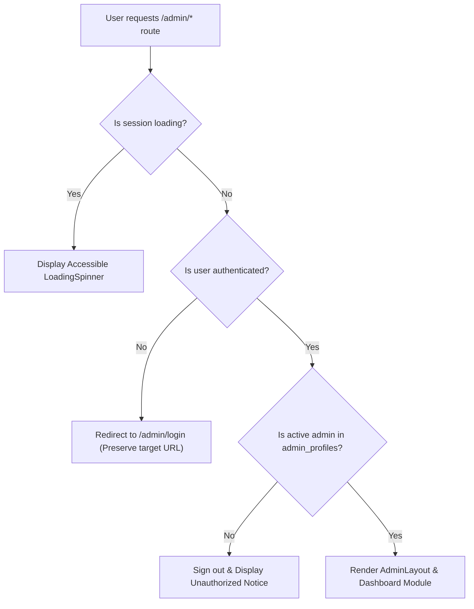

# OM OPEN MINDS — Authentication Architecture & Access Security

> **Document:** `docs/authentication-architecture.md`  
> **Institution:** OM OPEN MINDS (Specialized School for Children with Diverse Learning Needs)  
> **Engine:** Supabase Auth + PostgreSQL Security Definer RPC  
> **Phase:** Phase 3 — Administrative Identity & Access Control

---

## 1. Threat Model & Security Principles

Administrative access to OM OPEN MINDS controls confidential parent enquiries, admission statuses, child gallery media, and operational school notices. The authentication architecture enforces strict defense-in-depth:

```text
[Defense-in-Depth Authentication Flow]
│
├── Layer 1: Client Transport Security (HTTPS Only)
│   └── Credentials sent encrypted to Supabase Auth endpoint
│
├── Layer 2: Supabase Auth Verification (supabase.auth.signInWithPassword)
│   └── Validates email + bcrypt-hashed password; generates signed JWT
│
├── Layer 3: Database Identity Verification (public.admin_profiles check)
│   └── Ensures authenticated user ID exists in admin_profiles with is_active = true
│   └── Rejects accounts not authorized in the school directory (immediate signout)
│
├── Layer 4: Server-Side Role Enforcement (PostgreSQL SECURITY DEFINER functions)
│   └── is_admin() and is_super_admin() run inside PostgreSQL kernel
│
└── Layer 5: Row Level Security (RLS) Database Boundary
    └── All SQL queries evaluate is_admin() at the database engine level
    └── Frontend manipulation CANNOT bypass data restrictions
```

---

## 2. Prohibition of Public Administrator Registration

* **No Public Sign-Up Endpoint:** The application exposes **zero** public registration forms, invite-link self-registrations, or role selection dropdowns.
* **Closed Administrative Provisioning:**
  * New staff accounts can **only** be provisioned through two authorized channels:
    1. Direct provisioning by a `super_admin` via the Supabase Management Console.
    2. Execution of an authenticated migration script using the Supabase CLI:
       ```sql
       -- Example provisioning workflow by Super Admin:
       -- 1. Create auth user via Supabase Auth Admin API
       -- 2. Insert corresponding role record into admin_profiles
       INSERT INTO public.admin_profiles (id, full_name, role, is_active)
       VALUES ('<USER-UUID-FROM-AUTH>', 'Authorized Staff Name', 'staff', true);
       ```
* **Self-Elevation Defense:** Users cannot alter their own `role` or `is_active` state in `admin_profiles`. Only verified `super_admin` accounts have database-level update permissions.

---

## 3. Session Persistence, Auto-Refresh & Sign-Out

* **JWT Token Storage:** Client session tokens are managed securely by the Supabase JavaScript client, persisted in browser `localStorage`, and refreshed automatically before expiration.
* **Auto-Reauthentication:**
  * Upon initial application load, [`src/app/AuthProvider.tsx`](file:///c:/Manish/School%20project/src/app/AuthProvider.tsx) calls `supabase.auth.getSession()` to restore verified sessions.
  * Subscribes to `supabase.auth.onAuthStateChange` to react immediately to token refreshes, session expiries, or explicit signouts across browser tabs.
* **Immediate Revocation:**
  * If an administrator account is deactivated in `admin_profiles` (`is_active = false`), the `authService.verifyAdminRole()` check and all subsequent RLS queries immediately fail, locking the user out of all administrative endpoints.
* **Clean Sign-Out:**
  * Calling `authService.signOut()` terminates the remote session with Supabase Auth, wipes local storage tokens, resets React Auth context to `null`, and redirects to `/admin/login`.

---

## 4. Protected Route Architecture & Client Guard

Client-side route protection is enforced via [`src/app/ProtectedRoute.tsx`](file:///c:/Manish/School%20project/src/app/ProtectedRoute.tsx):



> **CRITICAL SECURITY RULE:** Frontend guards (`ProtectedRoute`) exist exclusively for user experience. **The true security boundary is enforced at the database level by Row Level Security (RLS).** An attacker bypassing frontend code can execute zero unauthorized database operations because the PostgreSQL engine enforces `public.is_admin()`.

