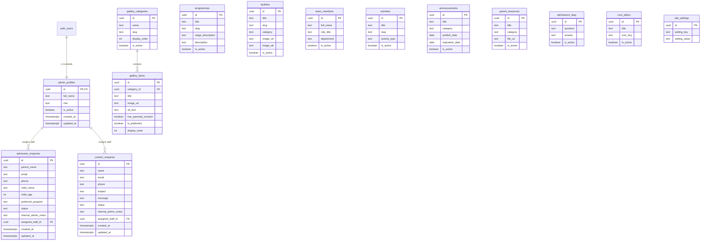

# OM OPEN MINDS — Database Relationships & Cardinality

> **Document:** `docs/database-relationships.md`  
> **Institution:** OM OPEN MINDS (Specialized School for Children with Diverse Learning Needs)  
> **Phase:** Phase 3 — Relational Integrity & Foreign Key Mapping

---

## 1. Relational Model & Entity Relationship Diagram (ERD)

The database schema maintains strict referential integrity. Sensitive user records and media items are guarded with appropriate deletion and assignment policies:

---

## 2. Foreign Key Relationship Specifications

### Relationship 1: `auth.users` $\rightarrow$ `public.admin_profiles`
* **Cardinality:** `1 : 1` (One-to-One).
* **Foreign Key:** `admin_profiles.id` $\rightarrow$ `auth.users(id)`.
* **Deletion Behaviour:** `ON DELETE CASCADE`.
* **Architectural Rationale:** When an administrative user account is removed from Supabase Auth (`auth.users`), their application profile must be immediately and automatically removed, terminating any administrative session or permission record.

### Relationship 2: `public.admin_profiles` $\rightarrow$ `public.admission_enquiries`
* **Cardinality:** `1 : N` (One-to-Many).
* **Foreign Key:** `admission_enquiries.assigned_staff_id` $\rightarrow$ `admin_profiles(id)`.
* **Deletion Behaviour:** `ON DELETE SET NULL`.
* **Architectural Rationale:** If a staff member leaves the school or their account is deactivated/deleted, submitted admission enquiries must **NOT** be deleted. The record is preserved in the database for continuity, and the `assigned_staff_id` is safely set to `NULL` so another staff member can be reassigned.

### Relationship 3: `public.admin_profiles` $\rightarrow$ `public.contact_enquiries`
* **Cardinality:** `1 : N` (One-to-Many).
* **Foreign Key:** `contact_enquiries.assigned_staff_id` $\rightarrow$ `admin_profiles(id)`.
* **Deletion Behaviour:** `ON DELETE SET NULL`.
* **Architectural Rationale:** Preserves historical communication logs and message audit records if the assigned administrator account is removed.

### Relationship 4: `public.gallery_categories` $\rightarrow$ `public.gallery_items`
* **Cardinality:** `1 : N` (One-to-Many).
* **Foreign Key:** `gallery_items.category_id` $\rightarrow$ `gallery_categories(id)`.
* **Deletion Behaviour:** `ON DELETE SET NULL`.
* **Architectural Rationale:** Deleting an album category does not trigger catastrophic cascading deletion of verified student photographs. The media items remain intact and can be recategorized or archived.

---

## 3. Independent & Uncoupled Entities

The following entities function as autonomous, self-contained collections optimized for high-performance retrieval and independent caching:
1. `public.programmes`: Standalone developmental pathway definitions queried by unique `slug` or `display_order`.
2. `public.facilities`: Standalone campus space specifications categorized by domain (`Sensory`, `Therapy`, `Learning`, `Recreation`).
3. `public.team_members`: Standalone faculty roster records grouped by department.
4. `public.activities`: Standalone event and extracurricular records sorted by date.
5. `public.announcements`: Autonomous ticker alerts filtered by current date intervals.
6. `public.parent_resources`: Standalone downloadable guides and calendar links.
7. `public.admissions_faqs`: Autonomous question-answer disclosure pairs.
8. `public.core_pillars`: Autonomous institutional differentiator cards.
9. `public.site_settings`: Global key-value operational configuration dictionary.

